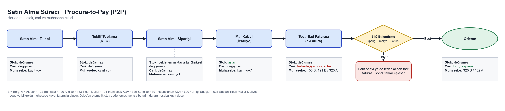
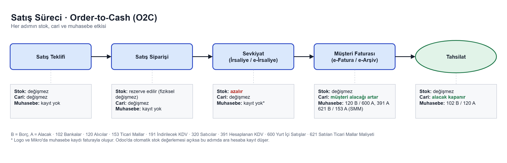

# ERP Süreç Haritaları / ERP Process Maps

Bir dağıtım firmasında satın alma (P2P) ve satış (O2C) süreçlerinin uçtan uca haritası. Her adımın **stok, cari ve muhasebe** üzerindeki etkisi, 3'lü eşleştirme kontrolü ve iki stok maliyetlendirme yönteminin (FIFO ve hareketli ağırlıklı ortalama) karşılaştırması.

## Problem / Problem

ERP'de bir belge kaydedildiğinde arka planda üç şey değişebilir: ambardaki stok, tedarikçi ya da müşteri bakiyesi (cari) ve muhasebe kayıtları. Bir ERP uygulama uzmanının şu sorulara hızlı cevap vermesi gerekir:

- Satın alma siparişi stoğu artırır mı? Borç ne zaman doğar?
- Sipariş 100, irsaliye 95, fatura 100 adet gelirse ne olur?
- Aynı ürün farklı fiyatlarla alındıysa satılan malın maliyeti (SMM) nasıl hesaplanır?

Bu repo bu soruları iki süreç haritası ve bir maliyetlendirme çalışma kitabıyla cevaplıyor.

## Ne yaptım / What I did

1. P2P ve O2C süreçlerini [draw.io](https://app.diagrams.net/) ile çizdim. Her adımın altına stok, cari ve muhasebe etkisini yazdım.
2. Satın alma sürecine **3'lü eşleştirme** (sipariş, irsaliye, fatura) karar adımını ekledim.
3. Excel'de 3 alış ve 2 satıştan oluşan örnek hareketlerle **FIFO** ve **hareketli ağırlıklı ortalama** hesabını formüllerle kurdum. Hareketler değiştirildiğinde tüm sonuçlar yeniden hesaplanır.

## Satın Alma Süreci / Procure-to-Pay (P2P)



| Adım | Stok | Cari | Muhasebe |
|---|---|---|---|
| Satın alma talebi | değişmez | değişmez | kayıt yok |
| Teklif toplama (RFQ) | değişmez | değişmez | kayıt yok |
| Satın alma siparişi | beklenen miktar artar | değişmez | kayıt yok |
| Mal kabul (irsaliye) | **artar** | değişmez | kayıt yok* |
| Tedarikçi faturası | değişmez | **tedarikçiye borç artar** | 153 B, 191 B / 320 A |
| Ödeme | değişmez | **borç kapanır** | 320 B / 102 A |

### 3'lü eşleştirme / Three-way match

Fatura ödenmeden önce üç belge karşılaştırılır: **ne istedik** (sipariş), **ne geldi** (irsaliye), **ne istendi** (fatura).

| Durum | Sonuç |
|---|---|
| Sipariş 100, irsaliye 95, fatura 100 | Miktar farkı. 95 adet onaylanır, 5 adet bloke edilir. Tedarikçiden fark iade faturası ya da kalan teslimat istenir. Siparişte 5 adet bekleyen (backorder) kalır. |
| Sipariş 100 × 10,00 ₺, fatura 100 × 10,50 ₺ | Fiyat farkı. Fatura onaya düşer; satın almacı farkı kabul eder ya da tedarikçiden fiyat farkı faturası istenir. |
| Sipariş 100, irsaliye 100, fatura 60 | Sorun yok. 60 adet ödenir, 40 adet "faturası beklenen irsaliye" olarak açık kalır. |

## Satış Süreci / Order-to-Cash (O2C)



| Adım | Stok | Cari | Muhasebe |
|---|---|---|---|
| Satış teklifi | değişmez | değişmez | kayıt yok |
| Satış siparişi | rezerve edilir | değişmez | kayıt yok |
| Sevkiyat (irsaliye / e-İrsaliye) | **azalır** | değişmez | kayıt yok* |
| Müşteri faturası (e-Fatura / e-Arşiv) | değişmez | **müşteri alacağı artar** | 120 B / 600 A, 391 A · 621 B / 153 A |
| Tahsilat | değişmez | **alacak kapanır** | 102 B / 120 A |

\* Logo ve Mikro gibi Türk ERP'lerinde muhasebe kaydı genellikle faturayla oluşur. Odoo'da otomatik stok değerlemesi açıksa mal kabul ve sevkiyatta ara hesaplara kayıt düşer.

**Hesaplar (Tek Düzen Hesap Planı):** 102 Bankalar · 120 Alıcılar · 153 Ticari Mallar · 191 İndirilecek KDV · 320 Satıcılar · 391 Hesaplanan KDV · 600 Yurt İçi Satışlar · 621 Satılan Ticari Mallar Maliyeti. B = Borç, A = Alacak.

## Stok Maliyetlendirme / Inventory Costing

Dosya: [`maliyet/maliyetlendirme_fifo_ortalama.xlsx`](maliyet/maliyetlendirme_fifo_ortalama.xlsx)

| Tarih | Hareket | Miktar | Birim fiyat |
|---|---|---:|---:|
| 01.11 | Alış A1 | 100 | 10 ₺ |
| 05.11 | Satış S1 | 80 | satış 20 ₺ |
| 10.11 | Alış A2 | 30 | 15 ₺ |
| 15.11 | Alış A3 | 50 | 17 ₺ |
| 20.11 | Satış S2 | 90 | satış 22 ₺ |

Çalışma kitabının sayfaları:

- **Hareketler:** girdiler (mavi hücreler değiştirilebilir).
- **Ortalama:** her alıştan sonra birim maliyet yeniden hesaplanır (Eldeki tutar ÷ Eldeki adet).
- **FIFO:** her satışın hangi lottan kaç adet aldığını gösteren tüketim tablosu.
- **Karşılaştırma:** iki yöntemin SMM, kalan stok ve brüt kâr sonuçları, sağlama kontrolüyle.

| Kalem | FIFO | Ağırlıklı ortalama | Fark |
|---|---:|---:|---:|
| S1 SMM | 800 ₺ | 800 ₺ | 0 ₺ |
| S2 SMM | 1.330 ₺ | 1.350 ₺ | −20 ₺ |
| **Toplam SMM** | **2.130 ₺** | **2.150 ₺** | **−20 ₺** |
| Kalan stok (10 adet) | 170 ₺ | 150 ₺ | +20 ₺ |
| Satış hasılatı | 3.580 ₺ | 3.580 ₺ | 0 ₺ |
| **Brüt kâr** | **1.450 ₺** | **1.430 ₺** | **+20 ₺** |

Sağlama: toplam alış 2.300 ₺ = SMM + kalan stok (FIFO: 2.130 + 170, ortalama: 2.150 + 150).

### FIFO ile ağırlıklı ortalama neden farklı sonuç verdi? / Why do the results differ?

Alış fiyatları 10 ₺'den 17 ₺'ye yükseldi. FIFO'da satışlar önce en eski ve ucuz lotlardan düşer. S2'nin 90 adedi A1'in kalan 20 adedinden (10 ₺), A2'nin 30 adedinden (15 ₺) ve A3'ün 40 adedinden (17 ₺) çıkar. Elde en yeni ve en pahalı lot olan A3'ten 10 adet kalır.

Ortalama yönteminde eski ve yeni fiyatlar karışır. 15.11'den sonra birim maliyet 15 ₺ olur ve S2'nin 90 adedinin hepsi bu fiyattan çıkar.

Sonuç olarak **fiyatlar yükselirken FIFO daha düşük SMM, daha yüksek kalan stok değeri ve daha yüksek kâr gösterir.** Fiyatlar düşerken tersi olur. İki yöntemde de toplam alış maliyeti aynıdır. Değişen tek şey, bu tutarın satılan mallar ile eldeki stok arasında nasıl paylaştırıldığıdır.

## Öğrendiklerim / What I learned

- Stok ve cari farklı belgelerle hareket eder. Stok irsaliyeyle, cari ve muhasebe faturayla değişir. Sipariş ise sadece bir taahhüttür.
- 3'lü eşleştirme, teslim alınmamış ya da yanlış fiyatlanmış mal için ödeme yapılmasını engelleyen temel kontroldür.
- KDV'nin iki ayrı hesabı vardır: alışta ödenen KDV indirilecek KDV (191), satışta tahsil edilen KDV hesaplanan KDV (391). Aradaki fark devlete ödenir.
- Maliyetlendirme yöntemi toplam maliyeti değiştirmez ama dönem kârını ve stok değerini değiştirir. Bu yüzden ERP kurulumunda yöntem baştan doğru seçilmelidir.

## Kullanılan araçlar / Tools

draw.io · Microsoft Excel

## Klasör yapısı / Structure

```
erp-surec-haritalari/
├── README.md
├── diyagramlar/
│   ├── p2p_satin_alma.png       # satın alma süreç haritası
│   ├── p2p_satin_alma.drawio    # düzenlenebilir kaynak
│   ├── o2c_satis.png            # satış süreç haritası
│   └── o2c_satis.drawio
└── maliyet/
    └── maliyetlendirme_fifo_ortalama.xlsx
```

---

Halit Samet Çelik ·
